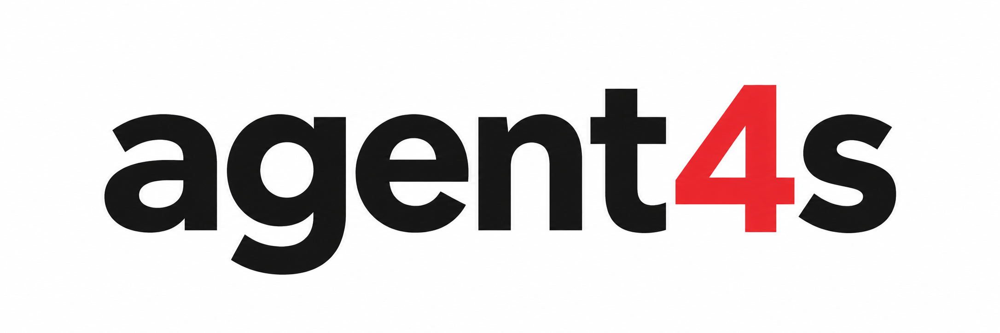

# 

Use agent4s to find a definition in Scala or Java, see who implements a trait, or preview the edits for a rename. It reads Git-tracked source files and returns file paths and line numbers. You can query a freshly cloned project before compiling it.

## Start in Claude Code

The plugin launcher supports macOS (Apple Silicon or Intel) and Linux x86-64. On Windows x64, use the native CLI or MCP server below. Install the plugin from your terminal with Claude Code 2.1.292 or later.

```sh
claude plugin install agent4s --marketplace scala-digest/agent4s
```

On earlier versions with plugin support, run `claude plugin marketplace add scala-digest/agent4s` and then `claude plugin install agent4s@agent4s-marketplace`.

Start a Claude Code session in a Scala repository and try this prompt.

```text
/agent4s:agent4s Where does this project start? Show the entry points with their files and line numbers.
```

In agent4s's own repository, you should find the CLI's `main` in `src/cli.scala` and the benchmark's `bench` in `src/bench.scala`. To repeat the lookup below in chat, ask “Where is `WorkspaceIndex` defined?” Run `/agent4s:setup` if you want Claude to save project-specific notes in `CLAUDE.md`.

## Start in Codex

```sh
codex plugin marketplace add scala-digest/agent4s
codex plugin add agent4s@agent4s-marketplace
```

Open a new session in your Scala project and ask “Use agent4s to find the entry points and show their source locations.”

## Try the CLI

On macOS (Apple Silicon or Intel) and Linux x86-64, the launcher downloads and verifies the pinned native binary on first use. You need Git, Bash, curl and shasum.

```sh
git clone https://github.com/scala-digest/agent4s.git
cd agent4s
./agent4s def WorkspaceIndex --verbose
```

The result includes the class declaration in `src/index/workspace.scala` and its line number.

Use `-w` to point the launcher at a different checkout. Replace the path below with the root of your Scala project.

```sh
./agent4s overview --concise -w /path/to/your/project
```

On Windows x64, download `scalex-windows-x64.exe` and run it from PowerShell, for example `.\scalex-windows-x64.exe overview --concise`. Release assets use the engine's original name, `scalex`. The launcher pins v0.5.0, whose executable prints `0.1.0` for `--version`. [Native downloads](https://github.com/scala-digest/agent4s/releases)

To run from source in this checkout, use `./mill run def WorkspaceIndex` or `mill.bat run def WorkspaceIndex` on Windows.

## Choose a query

The examples below are arguments after `./agent4s`. Substitute names from your project.

| Your question | Query | What you get |
| --- | --- | --- |
| Where is this type defined? | `def com.example.UserService --verbose` | File, line and declared signature |
| Who implements the trait? | `impl UserService` | Types whose declarations extend it |
| How does this method work? | `body findUser --in UserServiceLive --imports` | The source of the method and its file's imports |
| Where does the name appear? | `refs UserService --count` | Match counts by category. Drop `--count` for locations. |
| What would a rename change? | `rename UserService AccountService` | A preview of edits. Add `--apply` to write them. |
| Which tests mention this type? | `coverage UserService` | Matching lines in test files |

For more queries, run `./agent4s help`. The command reference covers filters, package exploration, call graphs, scaffolding and static checks. [Command reference](plugins/agent4s/skills/agent4s/references/commands.md)

## Choose a Claude Code skill

| Task | Skill |
| --- | --- |
| Navigate | `/agent4s:agent4s` looks up symbols and follows relationships. |
| Review | `/agent4s:audit` reviews code health. `/agent4s:bug-hunt` inspects static findings. `/agent4s:critique` evaluates design. |
| Refactor | `/agent4s:simplify` reduces complexity. `/agent4s:extract` pulls out shared code. `/agent4s:normalize` aligns code with project conventions. |
| Prepare a change for review | `/agent4s:harden` improves error handling. `/agent4s:polish` tidies names, imports and docs. |
| Configure a project | `/agent4s:setup` saves project notes. `/agent4s:semanticdb` configures compiler metadata. |
| Maintain the plugin | `/agent4s:doctor` diagnoses problems. `/agent4s:upgrade` updates the installation. `/agent4s:submit` reports feedback. |

## Connect an MCP client

Clients that support the Model Context Protocol can run the same CLI as a local server. For example, add this entry to `.cursor/mcp.json`, replacing the command with the absolute path to the launcher in your clone or the downloaded executable.

```json
{
  "mcpServers": {
    "agent4s": {
      "command": "/absolute/path/to/agent4s/agent4s",
      "args": ["mcp"]
    }
  }
}
```

Reload the client and look for `scalex_def` in its tools. Call it with `workspace` set to the absolute path of the agent4s checkout and `query` set to `WorkspaceIndex`. You should get the same source location as in the CLI example.

## How to read the results

- agent4s parses Scala 2, Scala 3 and Java declarations. It caches the index in `.scalex/index.bin`. For untracked files, local variables and generated code, check the source or build output.
- `refs` matches names in source text. Two types with the same name can appear in one result. `unused` reports candidates to review and `coverage` shows mentions in tests.
- If your compiler emits SemanticDB, `rename --semantic` can use compiler-resolved symbols, and `call-graph --semantic` can use them for outgoing calls. Read the diagnostic on stderr to see when the engine falls back to text matching.

Read about the index and its measured cold and warm performance, or use the repository's action in CI. [Architecture](docs/ARCHITECTURE.md) · [Benchmarks](docs/BENCHMARK.md) · [GitHub Action](action/README.md)

Built on scalex by Tu Nguyen, with Scalameta, JavaParser and graph layout code adapted from ascii-graphs. [scalex](https://github.com/nguyenyou/scalex) · [Contributing](CONTRIBUTING.md) · [MIT license](LICENSE)
